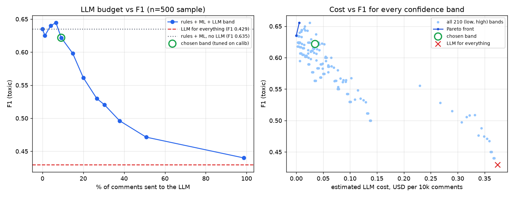
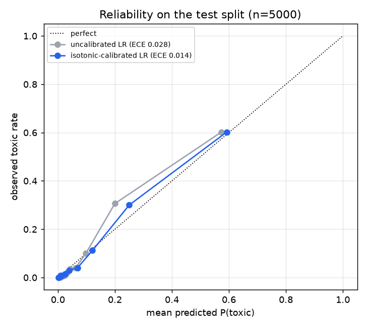
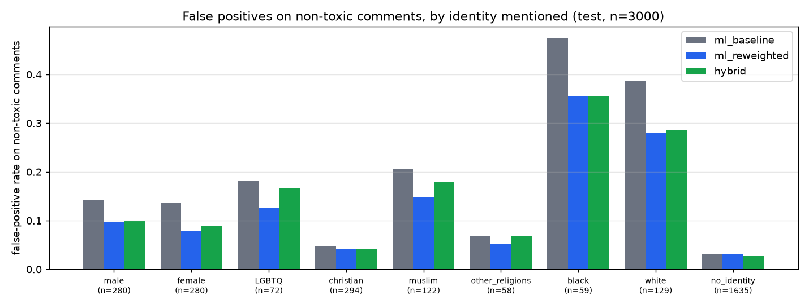

# Hybrid AI Comment Moderation

Moderating ~10,000 comments a day for a creator platform without sending every comment to an LLM.
Cheap, deterministic stages handle the clear-cut cases; a calibrated classifier handles the bulk;
an LLM sees only the comments the classifier is unsure about; and anything that could lead to an
account penalty goes to a person.

Built and measured on real, human-labelled public data (Civil Comments, via the WILDS release).
Every number in this README was produced by the scripts in this repo; the raw outputs are in
`results/`.

## Architecture

```mermaid
flowchart LR
    C[comment] --> R{Stage 1<br/>rules}
    R -- "emoji-only / short thanks" --> A[allow]
    R -- "3+ links, promo, repetition" --> S[spam hold]
    R -- "hashed lexicon hit" --> H[hide] --> Q
    R -- pass --> M[Stage 2<br/>TF-IDF + LR<br/>calibrated P(toxic)]
    M -- "p < band_low" --> A
    M -- "p >= band_high" --> H2[hide]
    M -- "band_low <= p < band_high" --> L[Stage 3<br/>LLM review<br/>JSON + Pydantic + retry]
    L -- "allowed category" --> A
    L -- "violating category" --> H3[hide]
    L -- "invalid after retries" --> F[ML threshold] --> Q
    H2 -- "p >= 0.90" --> Q
    H3 -- "threat / identity_attack" --> Q[(Stage 4<br/>human review queue<br/>SQLite)]
    Q --> P[human: allow / hide / penalize]
```

```
             +---------+   pass   +-------------------+  low-confidence band  +---------------+
comment ---> | rules   | -------> | TF-IDF + LogReg   | --------------------> | LLM reviewer  |
             | (µs)    |          | calibrated (ms)   |                       | JSON schema,  |
             +---------+          +-------------------+                       | retry, cache  |
              |  |   |               |            |                         +---------------+
        allow  spam  block       allow (p<lo)  hide (p>=hi)                     |          |
                     |                              |                        allow      hide
                     v                              v                                    |
             +-------------------------------------------------------------------------+
             | human review queue (SQLite): anything that could justify an account      |
             | penalty - lexicon blocks, p>=0.90 hides, threat / identity_attack, LLM    |
             | failures. Automated stages only hide/allow a comment; people penalize.    |
             +-------------------------------------------------------------------------+
```

| Stage | What it does | Why this method |
|---|---|---|
| 1. Rules (`rules.py`) | allow emoji/punctuation-only and short appreciation ("thank you!"); hold spam (3+ links, promo phrases, one token > 50% of a long comment); block tokens in a learned lexicon | Clear-cut cases need no model. The lexicon is **salted SHA-256 hashes** of normalised tokens (leetspeak folded, repeats collapsed), so the repo contains no plaintext slur list. It was learned from the training split (tokens with support >= 20 and training toxic-rate >= 0.85) plus a short curated list kept outside the repo. |
| 2. Classifier (`classifier.py`) | word 1-2-gram TF-IDF + hashed char 3-5-gram TF-IDF -> logistic regression, isotonic calibration (`CalibratedClassifierCV`, cv=3 on train) | Cheap, fast on CPU, and calibrated probabilities make the confidence band meaningful. Hashed char n-grams keep memory flat (the sandbox had 7 GB shared by three builds). |
| 3. LLM review (`llm.py`) | only comments with `band_low <= p < band_high`; batched; returns JSON validated by Pydantic: `category` in {toxicity, threat, insult, identity_attack, sarcasm_critique_ok, question, appreciation, neutral_ok}, `violates` (must agree with the category), `confidence`, `reason` | Context and intent (sarcasm, critique of a public figure, quoting) are where n-grams fail. Invalid items are re-asked with the validation error fed back; items still invalid after 3 retries fall back to the ML decision **and** go to a human. 429s honour `retry-after` without spending retries. Responses are cached on disk (JSONL) so runs are resumable and never pay twice. |
| 4. Human queue (`review_queue.py`) | SQLite queue + API to resolve items as allow / hide / penalize | The automated system only hides or allows a comment (reversible). Account consequences are a human decision. |

All thresholds live in [`configs/moderation.yaml`](configs/moderation.yaml) and are chosen on the
calibration split, never on the test split.

## Data and provenance

| | |
|---|---|
| Source | [`pietrolesci/civilcomments-wilds`](https://huggingface.co/datasets/pietrolesci/civilcomments-wilds) pinned at revision `c227534c`, a Hugging Face mirror of the [WILDS CivilComments](https://wilds.stanford.edu/datasets/#civilcomments) release (Koh et al., 2021) of the Jigsaw *Unintended Bias in Toxicity Classification* / Civil Comments corpus (Borkan et al., 2019) |
| License | Civil Comments is released under **CC0 1.0** (see the [`google/civil_comments`](https://huggingface.co/datasets/google/civil_comments) card). The mirror repo itself declares no license; its `processing_script.py` only binarises labels at >= 0.5 and de-duplicates. |
| Labels | `toxicity` = 1 when >= 50% of crowd raters marked the comment toxic. Subtype columns (threat, insult, identity_attack, ...) and **identity-mention columns** (male, female, LGBTQ, christian, muslim, other_religions, black, white) are the human annotations, binarised the same way. |
| Why this mirror | It is the only public, ungated copy that has both the subtype labels **and** the identity annotations in one table, which the fairness analysis needs. |
| Splits (seed 42) | train 80,000 and calibration 10,000 sampled from the WILDS train split; test 5,000 sampled from the WILDS test split with exact-text duplicates of train/calib removed. Toxic rate 11.2% / 11.3% / 11.2%; identity mentioned in 42.1% / 41.9% / 41.6%. |
| LLM sample | the first N comments of a seeded permutation of the test split (`data/splits/llm_order_uids.txt`) |
| Reproduce | `make data` downloads the pinned parquet files, checks nothing by hand, and rewrites `data/PROVENANCE.json` (file SHA-256s, split stats). Only the row uids are committed. |

## Quick start

```bash
python -m venv .venv && . .venv/bin/activate
pip install -r requirements-dev.txt
export PYTHONPATH=src:scripts

make test                      # 48 offline tests, no API key needed
make serve                     # FastAPI on :8000 using the committed model
curl -s localhost:8000/v1/moderate -H 'content-type: application/json' \
     -d '{"text": "Thanks for the great video!", "comment_id": "c1"}'

# full experiment pipeline (needs GROQ_API_KEY for the LLM stage)
make data lexicon train tune llm-sample evaluate sweep fairness errors
```

Docker: `docker build -t hybridmod . && docker run -p 8000:8000 -e GROQ_API_KEY hybridmod`.
Without `GROQ_API_KEY` the service still runs: band comments keep the ML decision and are queued
for human review (`review_reason = llm_unavailable`).

### API

| Method | Path | Purpose |
|---|---|---|
| POST | `/v1/moderate` | one comment `{text, comment_id?}` -> decision (action, stage, p_toxic, category, human_review, latency_ms) |
| POST | `/v1/moderate/batch` | up to 500 comments; ML runs vectorised, band comments share LLM requests; returns results + summary |
| GET | `/v1/review-queue?status=pending` | items waiting for a person, plus queue stats |
| POST | `/v1/review-queue/{id}/resolve` | `{human_action: allow / hide / penalize, reviewer, note}` |
| GET | `/v1/config` | live thresholds (no secrets) |
| GET | `/healthz` | liveness + whether the LLM stage is active |

## Results

All numbers below come from `scripts/evaluate.py` (tables are generated into this README by
`scripts/render_readme.py` from `results/metrics.json`). The threshold (`0.26`) and the LLM band
(`[0.181, 0.390)`, the 10% of calibration comments closest to the threshold) were fixed on the
calibration split before any test or LLM result was looked at.

* **Positive class** = toxic (crowd label). A hidden comment counts as a positive prediction;
  `spam_hold` does not.
* **Latency** is per comment on a shared 2-vCPU sandbox: rules + one single-comment
  `predict_proba` call, plus, for comments routed to the LLM, the wall time of the batched Groq
  request that judged it. LLM requests carry 8 comments (split in halves on HTTP 413).
* **Cost** = measured prompt/completion tokens x Groq's published on-demand price for
  `openai/gpt-oss-safeguard-20b` ($0.075 / 1M input, $0.30 / 1M output,
  [model page](https://console.groq.com/docs/model/openai/gpt-oss-safeguard-20b), read
  2026-11-06), projected to 10,000 comments. The experiments themselves ran on Groq's free tier.
  The cached-input discount is ignored, so the cost is an upper bound.
* **95% CI** = percentile bootstrap over comments (1,000 resamples).

### Head-to-head: all three scenarios on the same comments

<!-- GEN:sample_table -->
Fixed LLM sample, **n = 500** comments.

| scenario | F1 [95% CI] | precision | recall | false pos. | false neg. | latency p50 / p95 (ms) | LLM comments | LLM requests | est. $ per 10k | human reviews per 10k |
|---|---|---|---|---|---|---|---|---|---|---|
| (a) ML only | **0.624** [0.51, 0.72] | 0.542 | 0.736 | 33 | 14 | 3.3 / 4.3 | 0 | 0 | $0.000 | 60 |
| rules + ML (ablation) | **0.635** [0.53, 0.73] | 0.548 | 0.755 | 33 | 13 | 3.6 / 5.3 | 0 | 0 | $0.000 | 160 |
| (b) LLM for everything | **0.429** [0.32, 0.52] | 0.333 | 0.604 | 64 | 21 | 936 / 1,410 | 500 | 63 | $0.374 | 980 |
| (c) hybrid | **0.622** [0.51, 0.72] | 0.561 | 0.698 | 29 | 16 | 3.7 / 941 | 46 | 6 | $0.035 | 320 |
<!-- /GEN:sample_table -->

### Larger test subset: 3,000 of the 5,000 test comments (no LLM-for-everything: rate limits)

<!-- GEN:test_table -->
Test comments, **n = 3,000** (first rows of the fixed test permutation; a subset of the 5,000-comment test split that includes the LLM sample).

| scenario | F1 [95% CI] | precision | recall | false pos. | false neg. | latency p50 / p95 (ms) | LLM comments | LLM requests | est. $ per 10k | human reviews per 10k |
|---|---|---|---|---|---|---|---|---|---|---|
| (a) ML only | **0.617** [0.57, 0.66] | 0.557 | 0.692 | 188 | 105 | 3.4 / 4.4 | 0 | 0 | $0.000 | 100 |
| rules + ML (ablation) | **0.621** [0.58, 0.66] | 0.559 | 0.698 | 188 | 103 | 3.5 / 5.1 | 0 | 0 | $0.000 | 153 |
| (c) hybrid | **0.633** [0.59, 0.67] | 0.600 | 0.672 | 153 | 112 | 3.8 / 1,075 | 275 | 35 | $0.036 | 333 |
<!-- /GEN:test_table -->

### LLM budget vs F1 (threshold sweep of the confidence band)



Every comment of the LLM sample has a cached verdict, so any band can be simulated exactly. Left:
band widths defined on the calibration split by the share of comments they route. Right: every
(low, high) pair on a 0.05 grid with its Pareto front. This is analysis on test data; it was not
used to pick the band.

<!-- GEN:sweep_table -->
| calib share routed | band [low, high) | share routed on sample | F1 | FP | FN | est. $ per 10k |
|---|---|---|---|---|---|---|
| 0% | [0.260, 0.260) | 0.0% | 0.635 | 33 | 13 | $0.000 |
| 2% | [0.240, 0.281) | 1.2% | 0.625 | 35 | 13 | $0.004 |
| 5% | [0.218, 0.318) | 4.0% | 0.640 | 32 | 13 | $0.016 |
| 8% | [0.198, 0.353) | 6.6% | 0.645 | 29 | 14 | $0.025 |
| 10% | [0.181, 0.390) | 9.2% | 0.622 | 29 | 16 | $0.035 |
| 15% | [0.152, 0.486) | 14.8% | 0.598 | 29 | 18 | $0.056 |
| 20% | [0.134, 0.628) | 20.0% | 0.561 | 29 | 21 | $0.075 |
| 30% | [0.101, 1.000) | 26.6% | 0.530 | 33 | 22 | $0.101 |
| 40% | [0.077, 1.000) | 30.4% | 0.520 | 38 | 21 | $0.117 |
| 60% | [0.043, 1.000) | 37.8% | 0.496 | 47 | 20 | $0.143 |
| 80% | [0.026, 1.000) | 50.8% | 0.471 | 54 | 20 | $0.192 |
| 100% | [0.000, 1.010) | 98.6% | 0.440 | 64 | 20 | $0.368 |
<!-- /GEN:sweep_table -->

### Calibration



### Fairness: false positives on comments that mention identity groups

Identity mentions come from the Civil Comments human annotations, not from keyword matching.
FPR = share of non-toxic comments that were hidden.



<!-- GEN:fairness_table -->
| system | eval set | F1 | FPR, identity mentioned | FPR, no identity | gap | ratio |
|---|---|---|---|---|---|---|
| ml_baseline | full test split n=5,000 | 0.603 | 0.133 | 0.035 | +0.098 | 3.77x |
| ml_reweighted | full test split n=5,000 | 0.592 | 0.097 | 0.035 | +0.062 | 2.79x |
| ml_baseline | test subset n=3,000 | 0.617 | 0.134 | 0.031 | +0.103 | 4.29x |
| ml_reweighted | test subset n=3,000 | 0.605 | 0.098 | 0.032 | +0.066 | 3.07x |
| hybrid | test subset n=3,000 | 0.633 | 0.105 | 0.028 | +0.078 | 3.84x |
| ml_baseline | sample n=500 | 0.624 | 0.107 | 0.052 | +0.055 | 2.07x |
| llm_all | sample n=500 | 0.429 | 0.215 | 0.096 | +0.118 | 2.23x |
| hybrid | sample n=500 | 0.622 | 0.090 | 0.048 | +0.042 | 1.88x |
<!-- /GEN:fairness_table -->

## Engineering judgment: what the numbers say

**1. "Send everything to an LLM" lost on every axis we measured.** On the 500-comment head-to-head
the LLM-for-everything scenario had the lowest F1 (0.429 vs 0.624 for ML alone), almost twice the
false positives (64 vs 33), ~280x the median latency, and the highest projected API bill. The cause
is not one weak model: on the 176 comments both models judged, `gpt-oss-120b` and
`gpt-oss-safeguard-20b` agreed on 82% of decisions and both had precision around 0.31-0.34
against the crowd labels (`results/llm_model_comparison.json`). A written policy that flags
"rude or disrespectful" comments is stricter than the Civil Comments crowd threshold (>= 50% of
raters), so a zero-shot LLM over-flags relative to this ground truth. The classifier, trained on
the labels, has learned the crowd's threshold.

**2. The LLM is worth its cost only in a narrow band.** On the 500-comment sample the budget
curve peaks when 4-7% of comments are routed (F1 0.640-0.645 vs 0.635 for rules + ML with no LLM)
and falls steadily beyond that: the wider the band, the more comments the
over-strict LLM gets to overrule a classifier that was right. The band chosen on the calibration
split (10% of calib comments, 9.2% of the sample) lands just past that peak. On the sample the
hybrid cut false positives from 33 to 29 (precision 0.548 -> 0.561 vs rules + ML) but added three
false negatives, so its F1 (0.622) is statistically indistinguishable from ML alone (0.624);
the 95% bootstrap intervals overlap almost completely. On the larger 3,000-comment test subset
the same fixed band routed 275 comments (9.2%) and the hybrid did come out ahead: F1 0.633 vs
0.617 (ML only) and 0.621 (rules + ML), false positives 188 -> 153 (precision 0.559 -> 0.600 vs rules + ML)
for 9 more false negatives, at ~$0.036 per 10k comments. The intervals still overlap
([0.59, 0.67] vs [0.57, 0.66]), so this is a consistent lean, not a proven win. The grid optimum on the right-hand chart
(band [0.40, 0.45), F1 0.656) is selected on test data from 210 candidates and should be read as
noise until confirmed on a fresh split.

**3. What the LLM is actually for here.** Even where it does not move F1, the LLM stage turns an
opaque probability into a category (threat / insult / identity_attack / sarcasm_critique_ok /
question / appreciation) and a one-line reason. That is what routes penalty-eligible comments to a
person and what a moderator reads in the queue. The cost of having it is ~$0.035 per 10k comments
at the measured routing rate, about a tenth of LLM-for-everything.

**4. Calibration is what makes the band a dial.** Isotonic calibration halved the expected
calibration error on test (0.028 -> 0.014, same ROC-AUC), so "route the 10% least certain" means
the same thing on calibration and test data, and the routed share on test (9.2% of the sample)
matched the 10% target set on calibration; on the 3,000-comment subset it was 9.2% too.

**5. Rules are cheap but small.** The pre-moderated Civil Comments data contains few slurs, so the
lexicon fires rarely (66 of 10,000 calibration comments, precision 0.86); its job is the clear-cut
cases at microsecond cost and an auditable reason. Lexicon hits are queued for a human because a
keyword is not enough evidence for an account penalty.

**6. Fairness: the classifier's biggest problem, and only partly fixed.** On the full 5,000-comment test split
the baseline hides 13.3% of non-toxic comments that mention an identity group vs 3.5% of those
that do not (3.8x). The worst groups are the ones most often discussed in toxic threads: 51% of
non-toxic comments mentioning Black people and 38% mentioning white people were hidden (small
groups, 114 and 216 non-toxic comments). Reweighing the training data so identity mentions are
independent of the label cut the identity FPR to 9.7% (ratio 2.8x; Black 38%, white 27%) for a
1.1-point F1 cost (0.603 -> 0.592). That is a real improvement and still far from parity, which is
the main reason every penalty decision stays with a human. On the 3,000-comment subset the
hybrid (no reweighing) also lowered the identity FPR, 13.4% -> 10.6% vs the ML baseline on the
same comments (Black 47% -> 36%, white 39% -> 29%; 59 and 129 non-toxic comments), because the
LLM overturns some identity-mention false positives in the band.

## Limitations

* **Labels are not a platform policy.** Civil Comments crowd labels (news-site comments, 2015-2017,
  pre-moderated) define "toxic" here. A creator platform's own policy would need its own labelled
  set; the LLM numbers above mostly measure policy mismatch, not model quality.
* **Small LLM samples.** The head-to-head uses 500 comments (53 toxic) because the free tier caps
  daily tokens; F1 intervals are about +/-0.1 wide. The larger hybrid evaluation covers 3,000 of
  the 5,000 test comments for the same reason.
* **Model switch mid-run.** The LLM sample was started on `openai/gpt-oss-120b`; its free-tier
  daily token cap (shared with other projects on the same key) ran out after 176 comments, so all
  reported LLM results use `openai/gpt-oss-safeguard-20b` for every comment. The 120b verdicts are
  kept only for the side comparison.
* **No prompt tuning.** The policy prompt was written once and never tuned (tuning on test would
  leak; there was no token budget to tune on calibration). Few-shot examples drawn from the
  training labels are the obvious next step and would likely close much of the precision gap.
* **Latency** was measured on a shared 2-vCPU sandbox with two other builds running, and LLM
  latency includes free-tier queueing; production numbers would differ. Batching 8 comments per
  request means a band comment waits for its batch.
* **Cost** is projected from measured tokens at list price; it ignores prompt caching (Groq bills
  cached input at half price) and the human-review cost, which dominates in practice.
* **Fairness** uses identity annotations that exist only because raters supplied them; in
  production the system sees raw text, and the mitigation was tested for one attribute grouping
  (any identity vs none).
* **English only**; spam rules are simple heuristics and were not evaluated against a spam dataset.

## Repository layout

```
configs/moderation.yaml        thresholds, band, LLM + human-review policy, prices (with source URLs)
configs/lexicon_sha256.txt     hashed block lexicon (no plaintext)
src/hybridmod/                 rules, classifier, llm, pipeline, review_queue, api, metrics, data
scripts/                       prepare_data, build_lexicon, train, tune_band, run_llm_sample,
                               evaluate, sweep, fairness, calibration_plot, compare_llms,
                               error_analysis, render_readme
models/tfidf_lr.joblib         committed serving model (11.5 MB)
results/                       metrics, predictions (ids + labels, no text), charts, LLM cache
docs/ERROR_ANALYSIS.md         generated error analysis with real (masked) examples
tests/                         offline pytest suite (no network, no API key)
```

## License

Code: MIT. Data: Civil Comments, CC0 1.0; not redistributed here (only row ids).
